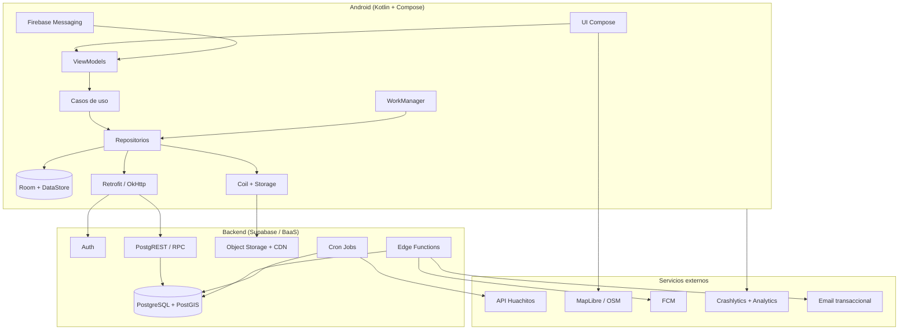

# AdoptMe — Especificación Técnica y de Requerimientos (SRS)

| Campo | Valor |
|---|---|
| Documento | Especificación de Requerimientos de Software y Arquitectura |
| Versión | 1.0 |
| Fecha | 2026-10-22 |
| Autores | Kevin Arroyo, Diego Cabezas, Nicolás Madariaga |
| Asignatura | ICC802 — Proyecto Integración |
| Estado | Borrador para revisión |
| Audiencia | Equipo de desarrollo, docente guía, evaluadores, futuros colaboradores |

---

## Tabla de contenido

1. [Resumen ejecutivo](#1-resumen-ejecutivo)
2. [Alcance del producto](#2-alcance-del-producto)
3. [Estado actual y brechas](#3-estado-actual-y-brechas)
4. [Actores y roles](#4-actores-y-roles)
5. [Requerimientos funcionales](#5-requerimientos-funcionales)
6. [Requerimientos no funcionales](#6-requerimientos-no-funcionales)
7. [Arquitectura objetivo](#7-arquitectura-objetivo)
8. [Modelo de datos](#8-modelo-de-datos)
9. [Contratos de API](#9-contratos-de-api)
10. [Integración con Huachitos.cl](#10-integración-con-huachitoscl)
11. [Seguridad y privacidad](#11-seguridad-y-privacidad)
12. [Infraestructura y DevOps](#12-infraestructura-y-devops)
13. [Observabilidad y analítica](#13-observabilidad-y-analítica)
14. [Estrategia de pruebas y calidad](#14-estrategia-de-pruebas-y-calidad)
15. [Cumplimiento legal](#15-cumplimiento-legal)
16. [Operación, moderación y soporte](#16-operación-moderación-y-soporte)
17. [Roadmap por fases](#17-roadmap-por-fases)
18. [Estimación de costos](#18-estimación-de-costos)
19. [Riesgos y mitigaciones](#19-riesgos-y-mitigaciones)
20. [Cuentas, credenciales y dependencias externas](#20-cuentas-credenciales-y-dependencias-externas)
21. [Anexos](#21-anexos)

---

## 1. Resumen ejecutivo

AdoptMe es una aplicación Android para centralizar la adopción responsable de animales y, a futuro, la información útil del ecosistema animal (reportes, animales perdidos, lugares pet-friendly). El código actual es un prototipo de interfaz que **no funciona como producto**: consume la API de Huachitos de forma defectuosa, no persiste datos, no tiene autenticación, no tiene backend propio, el mapa es un placeholder y las métricas no se registran.

Este documento define **todo lo que la aplicación debe tener para funcionar de extremo a extremo**, separando:

- **MVP operativo**: lo mínimo para que un usuario real vea animales reales, guarde intereses, contacte a un responsable y el responsable reciba el contacto.
- **Producto sostenible**: confianza (verificación y moderación), retención (mapa de perdidos/encontrados), trazabilidad (seguimiento post-adopción) y medición.
- **Fuera de alcance inicial**: chat propio, red social, tienda, gamificación y multi-país.

Principio rector de ingeniería: **ninguna funcionalidad visible puede depender de datos simulados**. Si un dato no existe, se oculta la función; no se inventa.

---

## 2. Alcance del producto

### 2.1 Objetivo del sistema

Permitir que una persona publique un animal en adopción con información verificable, que otra lo descubra según compatibilidad y cercanía, y que ambas coordinen el contacto y la adopción con trazabilidad mínima.

### 2.2 Alcance del MVP (Fase 1)

Incluye:

- Registro e inicio de sesión.
- Exploración de animales reales con filtros respaldados por datos existentes.
- Ficha detallada del animal.
- Guardado de intereses persistente.
- Contacto con el responsable (deep link a WhatsApp o formulario interno).
- Publicación de animales con fotos y datos de salud.
- Persistencia local y sincronización con backend.
- Moderación básica y reporte de fichas.
- Analítica y reporte de fallos.

No incluye (Fase 1):

- Chat en tiempo real dentro de la app.
- Mapa interactivo de reportes.
- Perfiles públicos tipo red social.
- Pagos, donaciones o tienda.
- Notificaciones push complejas (solo las esenciales: contacto y estado de publicación).

### 2.3 Alcance de fases posteriores

- Fase 2: mapa de animales perdidos/encontrados y lugares pet-friendly.
- Fase 3: seguimiento post-adopción y panel para fundaciones.
- Fase 4: panel municipal (B2G) y monetización.

### 2.4 Fuera de alcance permanente

- Venta de animales.
- Contenido de fauna protegida o tráfico de especies.
- Diagnóstico veterinario.
- Gestión de pagos de adopción (las cuotas, si existen, se coordinan fuera de la plataforma y se advierten como riesgo).

---

## 3. Estado actual y brechas

### 3.1 Inventario del código

| Componente | Archivo | Estado |
|---|---|---|
| Punto de entrada y navegación | `MainActivity.kt` | Funcional, navegación manual con `when` |
| ViewModel global | `viewmodel/AdoptMeViewModel.kt` | Funcional, sin persistencia |
| Repositorio mock + API | `data/repository/DogRepository.kt` | API rota, datos en memoria |
| Cliente HTTP | `data/api/HuachitosApiService.kt` | Contrato incorrecto |
| Modelos | `data/model/*.kt` | Solo perros, campos incompletos |
| Pantallas | `ui/screens/*.kt` | UI correcta, lógica simulada |
| Componentes | `ui/components/Components.kt` | Reutilizables, sin accesibilidad completa |
| Tema | `ui/theme/Theme.kt` | Correcto, sin modo oscuro |
| Pruebas | — | No existen |
| Backend | — | No existe |
| CI/CD | — | No existe |

### 3.2 Brechas críticas

| ID | Brecha | Evidencia | Impacto |
|---|---|---|---|
| G-01 | El contrato de la API no coincide con la respuesta real | `DogRepository.kt:196` espera `status`, la API devuelve `data/links/meta` | Los datos reales nunca se cargan |
| G-02 | Campos de descripción inexistentes | `HuachitosModels.kt:22` usa `desc`; la API trae `desc_fisica`, `desc_personalidad`, `desc_adicional` | Descripciones nulas o crash |
| G-03 | Sin paginación | Solo se consume la página 1 | Se pierde parte de la oferta |
| G-04 | Distancia aleatoria | `HuachitosModels.kt:45` | Filtro de radio es falso |
| G-05 | Filtros hardcodeados | `HuachitosModels.kt:47-51` | La compatibilidad mostrada es mentira |
| G-06 | Sin persistencia | `DogRepository.kt` usa `mutableListOf` | Intereses y publicaciones se pierden |
| G-07 | Publicación no compartida | `publishDog()` solo agrega al mock local | Nadie más ve la mascota |
| G-08 | Mapa simulado | `MapScreen.kt` | No hay geolocalización |
| G-09 | Sin autenticación | No existe | No hay responsable identificable |
| G-10 | Sin backend | No existe | No hay marketplace real |
| G-11 | Sin permisos de ubicación | `AndroidManifest.xml` solo declara `INTERNET` | Imposible calcular cercanía |
| G-12 | Sin pruebas ni CI | — | Regresiones inevitables |
| G-13 | Sin `.gitignore` | Raíz del proyecto | Riesgo de filtrar `local.properties` y artefactos |
| G-14 | Solo perros | Modelo `Dog`, emoji fijo | Contradice el alcance "mundo animal" |

---

## 4. Actores y roles

| Rol | Descripción | Permisos principales |
|---|---|---|
| Visitante | Usuario sin sesión | Ver catálogo público, filtrar, ver fichas |
| Adoptante | Usuario autenticado | Guardar intereses, iniciar contacto, reportar fichas |
| Publicante | Particular autenticado | Crear/editar/cerrar sus publicaciones, responder contactos |
| Organización | Fundación, refugio o rescatista | Igual que publicante + múltiples fichas + badge verificado |
| Moderador | Equipo AdoptMe | Revisar fichas reportadas, suspender cuentas, gestionar lugares |
| Administrador | Equipo AdoptMe | Todo lo anterior + configuración y métricas |
| Sistema | Procesos automáticos | Ingesta, expiración de fichas, notificaciones, respaldos |

Reglas de negocio transversales:

- RN-01: un usuario debe ser mayor de 18 años o contar con autorización de tutor.
- RN-02: una ficha debe tener al menos una foto y ubicación (comuna/región como mínimo).
- RN-03: una ficha expira si no se actualiza en 45 días; se notifica al publicante antes.
- RN-04: una adopción solo se marca como confirmada por el publicante.
- RN-05: un animal no puede estar en dos adopciones activas.
- RN-06: todo reporte de maltrato debe mostrar un aviso de que la app no es un servicio de emergencia.

---

## 5. Requerimientos funcionales

Formato: `RF-XXX` con prioridad MoSCoW (M = Must, S = Should, C = Could, W = Won't en esta fase).

### 5.1 Autenticación y cuenta

| ID | Requerimiento | Prioridad |
|---|---|---|
| RF-001 | Registro con email y contraseña, con verificación de email | M |
| RF-002 | Inicio de sesión con Google | S |
| RF-003 | Recuperación de contraseña | M |
| RF-004 | Cierre de sesión y revocación de sesión en todos los dispositivos | M |
| RF-005 | Perfil editable: nombre, foto, comuna, región, teléfono opcional | M |
| RF-006 | Selección de rol inicial (adoptante o publicante) | M |
| RF-007 | Eliminación de cuenta y datos asociados (derecho de supresión) | M |
| RF-008 | Consentimiento explícito de términos y política de privacidad | M |
| RF-009 | Bloqueo temporal tras intentos fallidos de login | S |
| RF-010 | Verificación de identidad para organizaciones (documento) | S |

### 5.2 Exploración y swipe

| ID | Requerimiento | Prioridad |
|---|---|---|
| RF-020 | Catálogo de animales paginado desde backend | M |
| RF-021 | Tarjeta con foto, nombre, edad, especie, tamaño, comuna y distancia | M |
| RF-022 | Swipe derecha = interés, izquierda = descartar, con animación | M |
| RF-023 | Botones accesibles equivalentes al swipe | M |
| RF-024 | Deshacer última acción (undo) | S |
| RF-025 | Filtros: especie, tamaño, energía, edad, compatibilidad, comuna, radio | M |
| RF-026 | Los filtros solo se muestran si el dato existe; nunca se infiere | M |
| RF-027 | Orden por cercanía usando ubicación real del usuario | M |
| RF-028 | Solicitud de permiso de ubicación con explicación y opción "solo comuna" | M |
| RF-029 | Estado vacío con acciones (ampliar radio, limpiar filtros) | M |
| RF-030 | Pull-to-refresh y paginación infinita | S |
| RF-031 | Caché offline de las últimas 50 tarjetas | S |
| RF-032 | Marcar ficha como vista | C |
| RF-033 | Compartir ficha por enlace profundo | S |

### 5.3 Ficha de detalle

| ID | Requerimiento | Prioridad |
|---|---|---|
| RF-040 | Galería de fotos con carga progresiva y placeholder | M |
| RF-041 | Descripción física, personalidad y adicional | M |
| RF-042 | Salud: vacunas, esterilización, chip, necesidades especiales | M |
| RF-043 | Compatibilidad: niños, perros, gatos, hogar | M |
| RF-044 | Ubicación aproximada (comuna) y distancia | M |
| RF-045 | Datos del responsable u organización con badge de verificación | M |
| RF-046 | Botón de contacto | M |
| RF-047 | Botón de reportar ficha (fraude, maltrato, datos falsos) | M |
| RF-048 | Fecha de publicación y última actualización | S |
| RF-049 | Fichas similares cercanas | C |

### 5.4 Intereses y contacto

| ID | Requerimiento | Prioridad |
|---|---|---|
| RF-050 | Guardar interés persistente en backend | M |
| RF-051 | Lista "Mis Intereses" con sincronización | M |
| RF-052 | Eliminar interés | M |
| RF-053 | Contacto por deep link a WhatsApp con mensaje prellenado | M |
| RF-054 | Formulario interno de contacto si no hay teléfono | S |
| RF-055 | Registro del contacto (quién, cuándo, por qué canal) | M |
| RF-056 | Estado del contacto: enviado, respondido, cerrado | S |
| RF-057 | Notificación al publicante cuando recibe un contacto | M |
| RF-058 | Recordatorio al adoptante si no hay respuesta en 48 h | C |
| RF-059 | Chat interno | W (Fase 3) |

### 5.5 Publicación

| ID | Requerimiento | Prioridad |
|---|---|---|
| RF-060 | Formulario por pasos con validación en línea | M |
| RF-061 | Subida de 1 a 6 fotos desde cámara o galería, con compresión | M |
| RF-062 | Datos obligatorios: especie, nombre, sexo, edad aproximada, tamaño, comuna, descripción, salud | M |
| RF-063 | Datos opcionales con valor "No sé" explícito | M |
| RF-064 | Vista previa antes de publicar | S |
| RF-065 | Edición y cierre de publicación | M |
| RF-066 | Renovación de ficha antes de expirar | M |
| RF-067 | Borrador local persistente | S |
| RF-068 | Aviso de tenencia responsable y compromiso de veracidad | M |
| RF-069 | Límite anti-spam: máximo 5 publicaciones activas por usuario | M |
| RF-070 | Publicación de organizaciones con múltiples fichas | S |

### 5.6 Adopción y seguimiento

| ID | Requerimiento | Prioridad |
|---|---|---|
| RF-080 | El publicante marca una ficha como "en proceso" y "adoptado" | M |
| RF-081 | Registro de adopción con adoptante y fecha | M |
| RF-082 | Confirmación bilateral (adoptante confirma recepción) | S |
| RF-083 | Seguimiento a 30 y 90 días con formulario breve | S |
| RF-084 | Panel de métricas para organización | C |
| RF-085 | Certificado o comprobante de adopción en PDF | C |

### 5.7 Reportes y mapa (Fase 2)

| ID | Requerimiento | Prioridad |
|---|---|---|
| RF-090 | Crear reporte con tipo, descripción, foto y ubicación | S (Fase 2) |
| RF-091 | Mapa con clustering de reportes y filtros por tipo | S (Fase 2) |
| RF-092 | Reporte de animal perdido con datos y recompensa opcional | S (Fase 2) |
| RF-093 | Compartir reporte por enlace y redes | S (Fase 2) |
| RF-094 | Estados del reporte: abierto, en gestión, resuelto, cerrado | S (Fase 2) |
| RF-095 | Solo roles autorizados cambian el estado a "en gestión/resuelto" | S (Fase 2) |
| RF-096 | Lugares pet-friendly, veterinarias y zonas de juego | C (Fase 2) |
| RF-097 | Aviso visible: "No somos un servicio de emergencia" | M |
| RF-098 | Anti-spam con captcha y límite de reportes por hora | M |

### 5.8 Administración y moderación

| ID | Requerimiento | Prioridad |
|---|---|---|
| RF-100 | Cola de fichas reportadas | M |
| RF-101 | Aprobar, ocultar o eliminar fichas | M |
| RF-102 | Suspender y banear cuentas | M |
| RF-103 | Registro de auditoría de acciones administrativas | M |
| RF-104 | Gestión de organizaciones y verificaciones | S |
| RF-105 | Panel de métricas operativas | S |
| RF-106 | Gestión de lugares del mapa | C (Fase 2) |

### 5.9 Notificaciones

| ID | Requerimiento | Prioridad |
|---|---|---|
| RF-110 | Push de nuevo contacto recibido | M |
| RF-111 | Push de ficha aprobada, rechazada o por expirar | M |
| RF-112 | Push de seguimiento post-adopción | S |
| RF-113 | Preferencias de notificación | S |
| RF-114 | Envío de emails transaccionales (bienvenida, recuperación, contacto) | M |

### 5.10 Soporte y contenido

| ID | Requerimiento | Prioridad |
|---|---|---|
| RF-120 | Centro de ayuda con guías de tenencia responsable | S |
| RF-121 | Formulario de contacto con soporte | S |
| RF-122 | Preguntas frecuentes sobre el proceso de adopción | C |
| RF-123 | Enlace a términos, privacidad y licencias de código abierto | M |

---

## 6. Requerimientos no funcionales

### 6.1 Rendimiento

| ID | Requerimiento | Métrica objetivo |
|---|---|---|
| RNF-001 | Arranque en frío | p95 < 2.5 s en dispositivo de gama media |
| RNF-002 | Respuesta de API | p95 < 400 ms en endpoints de lectura |
| RNF-003 | Carga de imágenes | < 1 s en 4G con caché caliente |
| RNF-004 | Scroll del swipe | 60 fps estables, sin jank |
| RNF-005 | Tamaño del APK/AAB | < 30 MB |
| RNF-006 | Consumo de batería en reposo | < 2 % por hora |
| RNF-007 | Uso de red por sesión típica | < 15 MB con caché |

### 6.2 Disponibilidad y confiabilidad

| ID | Requerimiento | Métrica objetivo |
|---|---|---|
| RNF-010 | Disponibilidad del backend | 99.5 % en MVP, 99.9 % en producción |
| RNF-011 | Crash-free sessions | ≥ 99.5 % |
| RNF-012 | ANR rate | < 0.5 % |
| RNF-013 | Recuperación ante fallo de API | Fallback a caché + reintento con backoff |
| RNF-014 | Respaldos | Diarios con retención de 7 días; PITR en producción |
| RNF-015 | RPO / RTO | RPO ≤ 24 h / RTO ≤ 4 h en MVP |

### 6.3 Escalabilidad

| ID | Requerimiento | Métrica objetivo |
|---|---|---|
| RNF-020 | Usuarios concurrentes | 500 en MVP, 10 000 en producción |
| RNF-021 | Fichas activas | 10 000 sin degradación |
| RNF-022 | Almacenamiento de imágenes | Escalable a 50 GB con CDN |
| RNF-023 | Procesos de ingesta y expiración | Idempotentes y reintentables |

### 6.4 Seguridad

| ID | Requerimiento |
|---|---|
| RNF-030 | Todas las comunicaciones por HTTPS/TLS 1.2+ |
| RNF-031 | Autenticación con JWT y refresh tokens rotativos |
| RNF-032 | Autorización a nivel de fila en base de datos (RLS) |
| RNF-033 | Contraseñas con hash Argon2/bcrypt y políticas mínimas |
| RNF-034 | Secretos fuera del repositorio; rotación documentada |
| RNF-035 | Validación y sanitización de todas las entradas, incluido HTML de terceros |
| RNF-036 | Protección anti-abuso: rate limiting y captcha en escrituras públicas |
| RNF-037 | Ofuscación y minificación en release (R8) |
| RNF-038 | Sin logs de datos personales ni tokens |
| RNF-039 | Escaneo de dependencias y de secretos en CI |
| RNF-040 | Revisión OWASP MASVS antes de publicar |

### 6.5 Privacidad

| ID | Requerimiento |
|---|---|
| RNF-041 | Minimización de datos: solo lo necesario |
| RNF-042 | Consentimiento granular para ubicación y notificaciones |
| RNF-043 | Ubicación almacenada con precisión reducida para fichas públicas |
| RNF-044 | Derecho de acceso, rectificación y supresión implementado |
| RNF-045 | Política de retención: reportes cerrados se anonimizan a los 12 meses |
| RNF-046 | Exportación de datos del usuario en formato legible |

### 6.6 Usabilidad y accesibilidad

| ID | Requerimiento |
|---|---|
| RNF-050 | Cumplir WCAG 2.1 AA en contraste, foco y tamaño táctil (48 dp) |
| RNF-051 | Soporte completo de TalkBack y contenido descriptivo en imágenes |
| RNF-052 | Soporte de escalado de fuente hasta 200 % sin romper layout |
| RNF-053 | Modo claro y oscuro |
| RNF-054 | Todos los textos externalizados en `strings.xml` |
| RNF-055 | Español (Chile) como idioma base; estructura lista para inglés |
| RNF-056 | Manejo explícito de estados: cargando, vacío, error y sin conexión |
| RNF-057 | Navegación con botón atrás coherente y estado preservado |

### 6.7 Compatibilidad

| ID | Requerimiento |
|---|---|
| RNF-060 | Android 8.0 (API 26) o superior |
| RNF-061 | `targetSdk` igual al exigido por Google Play al momento de publicar |
| RNF-062 | Soporte de pantallas de 4.7" a tablets, orientación vertical |
| RNF-063 | Funcionamiento en redes 3G/4G/5G y Wi-Fi inestable |
| RNF-064 | Sin dependencia de servicios de Google para funciones críticas |

### 6.8 Mantenibilidad

| ID | Requerimiento |
|---|---|
| RNF-070 | Arquitectura modular por feature |
| RNF-071 | Cobertura de pruebas ≥ 70 % en dominio y datos |
| RNF-072 | Lint, detekt y ktlint sin errores en CI |
| RNF-073 | Documentación de decisiones de arquitectura (ADR) |
| RNF-074 | Versionado semántico y changelog |
| RNF-075 | Tiempo de reemplazo de un desarrollador < 1 semana |

---

## 7. Arquitectura objetivo

### 7.1 Vista general



### 7.2 Decisiones de arquitectura

| ADR | Decisión | Justificación |
|---|---|---|
| ADR-001 | Backend BaaS (Supabase) en lugar de backend propio | Equipo de 3 personas, sin operación 24/7; Postgres + Auth + Storage + RLS cubren el MVP |
| ADR-002 | PostgreSQL + PostGIS | Búsquedas por cercanía y clustering sin servicio adicional |
| ADR-003 | Compose + Navigation Compose | Navegación tipada y escalable; reemplaza el `when` actual |
| ADR-004 | Hilt para inyección de dependencias | Testabilidad y modularidad |
| ADR-005 | Room + DataStore | Persistencia local, caché offline y preferencias |
| ADR-006 | Paging 3 | Paginación del catálogo sin duplicar lógica |
| ADR-007 | MapLibre + OpenStreetMap | Evita costos y requisitos de facturación de Google Maps |
| ADR-008 | WhatsApp deep link antes que chat propio | Contacto inmediato sin costo de moderación ni infraestructura |
| ADR-009 | Repositorio como interfaz | Permite alternar mock, caché y API sin tocar ViewModels |
| ADR-010 | Firebase Crashlytics + Analytics | Observabilidad gratuita y rápida de integrar |

### 7.3 Capas del cliente

```
app/                         composición, navegación, DI
core/designsystem/           tema, componentes, tipografía
core/network/                Retrofit, interceptores, DTOs
core/database/               Room, DAOs, migraciones
core/datastore/              preferencias y sesión
core/common/                 utilidades, resultado, errores
core/analytics/              wrapper de eventos
feature/auth/
feature/home/
feature/detail/
feature/interests/
feature/publish/
feature/profile/
feature/reports/             Fase 2
feature/map/                 Fase 2
feature/moderation/          interno
```

### 7.4 Flujo de datos

1. UI observa `StateFlow<UiState>` del ViewModel.
2. ViewModel invoca un caso de uso.
3. El caso de uso consulta el repositorio.
4. El repositorio decide: caché local, red o ambos (single source of truth = Room).
5. Las escrituras se encolan si no hay red y se reintentan con WorkManager.
6. Los errores se modelan como `Result` y se traducen a mensajes de UI.

### 7.5 Selección de tecnología del cliente

| Necesidad | Tecnología |
|---|---|
| UI | Jetpack Compose + Material 3 |
| Navegación | Navigation Compose |
| DI | Hilt |
| Red | Retrofit + OkHttp + Kotlinx Serialization |
| Persistencia | Room + DataStore |
| Paginación | Paging 3 |
| Imágenes | Coil con caché en disco |
| Ubicación | FusedLocationProviderClient |
| Mapas | MapLibre Native + tiles OSM |
| Notificaciones | Firebase Cloud Messaging |
| Trabajo en segundo plano | WorkManager |
| Cámara | CameraX |
| Observabilidad | Firebase Crashlytics + Analytics |
| Pruebas | JUnit 5, MockK, Turbine, Compose UI Test, MockWebServer |

---

## 8. Modelo de datos

### 8.1 Entidades principales

| Entidad | Propósito |
|---|---|
| `profiles` | Datos públicos y rol del usuario |
| `organizations` | Fundaciones y refugios verificados |
| `animals` | Fichas de animales |
| `animal_media` | Fotos de cada ficha |
| `interests` | Animales guardados por usuario |
| `contact_requests` | Contactos iniciados |
| `adoptions` | Adopciones confirmadas |
| `follow_ups` | Seguimientos post-adopción |
| `reports` | Reportes de animales en riesgo o perdidos |
| `report_media` | Evidencia fotográfica |
| `places` | Veterinarias, parques, lugares pet-friendly |
| `notifications` | Historial de notificaciones |
| `device_tokens` | Tokens FCM |
| `moderation_flags` | Denuncias y cola de moderación |
| `audit_log` | Trazabilidad de acciones administrativas |
| `consents` | Consentimientos legales versionados |
| `ingest_runs` | Ejecuciones de ingesta externa |

### 8.2 Esquema SQL de referencia

```sql
create extension if not exists "postgis";
create extension if not exists "pgcrypto";

create type user_role as enum ('adopter','publisher','organization','moderator','admin');
create type animal_status as enum ('draft','active','in_process','adopted','expired','hidden','removed');
create type species as enum ('dog','cat','rabbit','other');
create type size as enum ('small','medium','large');
create type energy as enum ('low','medium','high');
create type report_type as enum ('danger','lost','found','street','at_risk','abuse');
create type report_status as enum ('open','in_progress','resolved','closed');
create type moderation_status as enum ('pending','approved','rejected');

create table profiles (
  id uuid primary key references auth.users(id) on delete cascade,
  role user_role not null default 'adopter',
  display_name text not null,
  phone text,
  avatar_url text,
  region text,
  comuna text,
  location geography(point, 4326),
  is_adult boolean not null default false,
  verified_at timestamptz,
  created_at timestamptz not null default now(),
  updated_at timestamptz not null default now()
);

create table organizations (
  id uuid primary key default gen_random_uuid(),
  owner_id uuid not null references profiles(id),
  name text not null,
  type text not null,
  rut text,
  website text,
  logo_url text,
  region text,
  comuna text,
  verified_at timestamptz,
  created_at timestamptz not null default now()
);

create table animals (
  id uuid primary key default gen_random_uuid(),
  source text not null default 'adoptme',
  external_id text,
  name text not null,
  species species not null,
  breed text,
  sex text check (sex in ('male','female','unknown')),
  age_text text,
  birth_date date,
  size size,
  energy energy,
  color text,
  description_physical text,
  description_personality text,
  description_extra text,
  sterilized boolean,
  vaccinated boolean,
  microchip text,
  special_needs text,
  good_with_kids boolean,
  good_with_dogs boolean,
  good_with_cats boolean,
  house_trained boolean,
  region text not null,
  comuna text not null,
  location geography(point, 4326),
  status animal_status not null default 'draft',
  moderation_status moderation_status not null default 'pending',
  published_by uuid not null references profiles(id),
  organization_id uuid references organizations(id),
  source_url text,
  created_at timestamptz not null default now(),
  updated_at timestamptz not null default now(),
  expires_at timestamptz not null default now() + interval '45 days',
  adopted_at timestamptz,
  unique (source, external_id)
);

create index animals_status_idx on animals (status, moderation_status);
create index animals_geo_idx on animals using gist (location);
create index animals_region_idx on animals (region, comuna);
create index animals_search_idx on animals using gin (to_tsvector('spanish', coalesce(name,'') || ' ' || coalesce(breed,'') || ' ' || coalesce(description_physical,'')));

create table animal_media (
  id uuid primary key default gen_random_uuid(),
  animal_id uuid not null references animals(id) on delete cascade,
  url text not null,
  sort_order int not null default 0,
  is_cover boolean not null default false,
  created_at timestamptz not null default now()
);

create table interests (
  id uuid primary key default gen_random_uuid(),
  user_id uuid not null references profiles(id) on delete cascade,
  animal_id uuid not null references animals(id) on delete cascade,
  created_at timestamptz not null default now(),
  unique (user_id, animal_id)
);

create table contact_requests (
  id uuid primary key default gen_random_uuid(),
  animal_id uuid not null references animals(id) on delete cascade,
  requester_id uuid not null references profiles(id),
  owner_id uuid not null references profiles(id),
  channel text not null check (channel in ('whatsapp','form','email')),
  message text,
  status text not null default 'sent' check (status in ('sent','responded','closed')),
  created_at timestamptz not null default now(),
  responded_at timestamptz
);

create table adoptions (
  id uuid primary key default gen_random_uuid(),
  animal_id uuid not null references animals(id),
  adopter_id uuid not null references profiles(id),
  owner_id uuid not null references profiles(id),
  status text not null default 'pending' check (status in ('pending','confirmed','cancelled')),
  adopted_at date,
  confirmed_at timestamptz,
  notes text,
  unique (animal_id) where status <> 'cancelled'
);

create table follow_ups (
  id uuid primary key default gen_random_uuid(),
  adoption_id uuid not null references adoptions(id) on delete cascade,
  due_at date not null,
  completed_at timestamptz,
  outcome text,
  notes text
);

create table reports (
  id uuid primary key default gen_random_uuid(),
  reporter_id uuid not null references profiles(id),
  type report_type not null,
  description text not null,
  region text not null,
  comuna text not null,
  location geography(point, 4326),
  status report_status not null default 'open',
  resolver_id uuid references profiles(id),
  created_at timestamptz not null default now(),
  resolved_at timestamptz
);

create index reports_geo_idx on reports using gist (location);
create index reports_status_idx on reports (status, type, created_at desc);

create table places (
  id uuid primary key default gen_random_uuid(),
  type text not null check (type in ('vet','park','pet_friendly','shelter')),
  name text not null,
  address text,
  location geography(point, 4326) not null,
  schedule text,
  verified boolean not null default false,
  created_at timestamptz not null default now()
);

create table device_tokens (
  user_id uuid not null references profiles(id) on delete cascade,
  token text not null,
  platform text not null default 'android',
  updated_at timestamptz not null default now(),
  primary key (user_id, token)
);

create table moderation_flags (
  id uuid primary key default gen_random_uuid(),
  reporter_id uuid references profiles(id),
  animal_id uuid references animals(id) on delete cascade,
  report_id uuid references reports(id) on delete cascade,
  reason text not null,
  details text,
  status text not null default 'open',
  created_at timestamptz not null default now()
);

create table audit_log (
  id bigserial primary key,
  actor_id uuid references profiles(id),
  action text not null,
  entity text not null,
  entity_id uuid,
  metadata jsonb,
  created_at timestamptz not null default now()
);
```

### 8.3 Reglas de integridad

- Un animal `active` debe tener al menos una fila en `animal_media`.
- `expires_at` se recalcula al editar o renovar.
- `adoptions` no puede tener dos registros activos para el mismo animal.
- `interests` es idempotente por la restricción única.
- Los reportes cerrados se anonimizan (`reporter_id = null`) a los 12 meses.
- Toda escritura administrativa genera fila en `audit_log`.

---

## 9. Contratos de API

### 9.1 Convenciones

- Base: `https://<proyecto>.supabase.co/rest/v1` o `/functions/v1`.
- Autenticación: `Authorization: Bearer <jwt>`.
- Formato: JSON UTF-8.
- Fechas: ISO 8601 UTC.
- Paginación: `page` y `limit` (máx. 100), respuesta con `meta`.
- Errores: RFC 7807 (`type`, `title`, `status`, `detail`, `instance`).
- Idempotencia: cabecera `Idempotency-Key` en POST críticos.
- Rate limit: 60 req/min anónimo, 300 req/min autenticado, 10 escrituras/min.

### 9.2 Endpoints del MVP

| Método | Ruta | Descripción | Auth |
|---|---|---|---|
| GET | `/animals` | Catálogo con filtros y paginación | No |
| GET | `/animals/{id}` | Detalle de ficha | No |
| POST | `/animals` | Crear ficha | Sí |
| PATCH | `/animals/{id}` | Editar ficha propia | Sí |
| DELETE | `/animals/{id}` | Cerrar publicación propia | Sí |
| POST | `/animals/{id}/media` | Registrar foto subida | Sí |
| POST | `/animals/{id}/renew` | Renovar vigencia | Sí |
| GET | `/interests` | Intereses del usuario | Sí |
| POST | `/interests` | Guardar interés | Sí |
| DELETE | `/interests/{animalId}` | Eliminar interés | Sí |
| POST | `/contact-requests` | Registrar contacto | Sí |
| GET | `/contact-requests` | Contactos recibidos/enviados | Sí |
| PATCH | `/contact-requests/{id}` | Cambiar estado | Sí |
| POST | `/adoptions` | Registrar adopción | Sí |
| PATCH | `/adoptions/{id}` | Confirmar o cancelar | Sí |
| POST | `/flags` | Reportar ficha o usuario | Sí |
| GET | `/me` | Perfil actual | Sí |
| PATCH | `/me` | Actualizar perfil | Sí |
| DELETE | `/me` | Eliminar cuenta | Sí |
| POST | `/devices` | Registrar token FCM | Sí |
| GET | `/places` | Lugares (Fase 2) | No |
| GET | `/reports` | Reportes por bounding box (Fase 2) | No |
| POST | `/reports` | Crear reporte (Fase 2) | Sí |
| PATCH | `/reports/{id}/status` | Cambiar estado (Fase 2) | Moderador |
| GET | `/health` | Estado del servicio | No |

### 9.3 Ejemplo de consulta del catálogo

```http
GET /animals?species=dog&region=RM&comuna=Nunoa&size=medium&good_with_kids=true
    &lat=-33.4569&lng=-70.6483&radius_km=15&page=1&limit=20&sort=distance
```

```json
{
  "data": [
    {
      "id": "b0f1c2d3-...",
      "name": "Panda",
      "species": "dog",
      "breed": "Boyero Australiano",
      "sex": "male",
      "age_text": "11 meses",
      "size": "medium",
      "energy": "high",
      "region": "Los Lagos",
      "comuna": "Purranque",
      "distance_km": 3.4,
      "cover_url": "https://cdn.adoptme.cl/animals/...jpg",
      "sterilized": false,
      "vaccinated": true,
      "good_with_kids": null,
      "status": "active",
      "updated_at": "2026-10-17T13:54:45Z"
    }
  ],
  "meta": {
    "page": 1,
    "limit": 20,
    "total": 114,
    "has_next": true
  }
}
```

Nota: `good_with_kids: null` significa **dato desconocido**. La UI debe mostrarlo como "No informado", nunca como `false` ni `true`.

### 9.4 Formato de error

```json
{
  "type": "https://adoptme.cl/errors/validation",
  "title": "Datos inválidos",
  "status": 422,
  "detail": "El campo 'comuna' es obligatorio.",
  "instance": "/animals",
  "errors": [
    { "field": "comuna", "code": "required" }
  ]
}
```

### 9.5 Autorización

- RLS en `animals`: lectura pública solo de `status = 'active'` y `moderation_status = 'approved'`; escritura solo del `published_by`.
- RLS en `interests`: el usuario solo ve y modifica los suyos.
- RLS en `contact_requests`: visibles para emisor y receptor.
- RLS en `reports`: lectura pública de campos no sensibles; escritura autenticada; cambio de estado solo moderador o responder.
- Funciones `security definer` solo para operaciones administrativas auditadas.

---

## 10. Integración con Huachitos.cl

### 10.1 Contrato real observado

```
GET https://huachitos.cl/api/animales
{
  "data": [ { ... } ],
  "links": { "first": "...", "last": "...", "prev": null, "next": "..." },
  "meta": { "current_page": 1, "last_page": 2, "per_page": 100, "total": 114 }
}
```

Campos por animal: `id`, `nombre`, `tipo`, `color`, `edad`, `estado`, `genero`,
`desc_fisica`, `desc_personalidad`, `desc_adicional`, `esterilizado`, `vacunas`,
`imagen`, `equipo`, `region`, `comuna`, `url`.

### 10.2 Reglas de integración

1. **No consumir en el cliente en producción.** La ingesta se hace en backend (cron cada 6 h) para no exponer la dependencia ni golpear la API desde miles de dispositivos.
2. **Paginación completa**: recorrer todas las páginas respetando `meta.last_page`.
3. **Mapeo explícito**:
   - `tipo` → `species` (`Perro` → `dog`, `Gato` → `cat`, `Conejo` → `rabbit`, otro → `other`).
   - `estado` → `status` (`adopcion` → `active`, `encontrado` → reporte de tipo `found` si aplica).
   - `desc_*` → columnas correspondientes, con el HTML sanitizado.
   - `color` se conserva como color de acento de la ficha.
   - `equipo` → `organization_id` si existe; si es "Privado", queda sin organización.
4. **Deduplicación** por `(source='huachitos', external_id)`.
5. **Bajas**: si un `external_id` no aparece en dos ejecuciones consecutivas, se marca `expired`, no se borra.
6. **Atribución**: toda ficha externa muestra "Fuente: Huachitos.cl" y enlace al original.
7. **Imágenes**: no hacer hotlinking. Descargar a almacenamiento propio con permiso o acuerdo, o usar la URL original solo si existe autorización expresa.
8. **Cumplimiento**: revisar términos de uso y solicitar autorización formal antes de operar comercialmente.
9. **Observabilidad**: registrar `ingest_runs` con inicio, fin, páginas, insertados, actualizados, errores.
10. **Tolerancia a fallos**: si la ingesta falla, se conserva la última data válida y se alerta.

### 10.3 Datos que la API no entrega

No existen tamaño, energía, compatibilidad con niños/perros/gatos, ni coordenadas. Por lo tanto:

- La UI **no debe mostrar esos filtros** para fichas externas.
- La compatibilidad solo se habilita cuando el publicante la completa.
- La distancia se calcula solo si hay coordenadas; si no, se muestra la comuna y se excluye del orden por cercanía.
- El "No informado" es un estado de primera clase en la UI y en el modelo.

---

## 11. Seguridad y privacidad

### 11.1 Modelo de amenazas

| Amenaza | Vector | Mitigación |
|---|---|---|
| Fichas falsas o fraudulentas | Publicación libre | Verificación, moderación, reporte, límites |
| Suplantación de identidad | Cuentas sin verificar | Email verificado, verificación de organizaciones |
| Scraping masivo | API pública | Rate limit, paginación máxima, captcha |
| Inyección | Campos de texto y HTML de terceros | Validación, sanitización, consultas parametrizadas |
| Exposición de datos personales | Logs, respuestas, ubicación exacta | Minimización, RLS, redondeo de coordenadas, sin PII en logs |
| Abuso de reportes | Creación masiva | Captcha, límites por hora, reputación |
| Interceptación | Red | TLS, certificate pinning opcional |
| Robo de tokens | Almacenamiento local | EncryptedSharedPreferences/Keystore |
| Ingeniería inversa | APK | R8, ofuscación, sin secretos en el binario |

### 11.2 Reglas de privacidad

- La ubicación exacta de una ficha nunca es pública; se muestra comuna y distancia redondeada.
- Los reportes muestran coordenadas aproximadas (radio de 200 m) al público.
- El teléfono solo se revela al iniciar contacto, con consentimiento.
- Los datos de menores no se recopilan; la app declara +18.
- Los reportes cerrados se anonimizan a los 12 meses.
- Se registra la versión del consentimiento aceptado.

### 11.3 Gestión de secretos

- `local.properties` fuera del repositorio (crear `.gitignore`).
- Claves de Supabase y mapas en variables de entorno o `secrets.properties` no versionado.
- Claves de firma en CI como secretos cifrados.
- Rotación documentada y responsable asignado.

---

## 12. Infraestructura y DevOps

### 12.1 Entornos

| Entorno | Propósito | Backend | Datos |
|---|---|---|---|
| Local | Desarrollo | Supabase local (Docker) | Semilla |
| Staging | Pruebas internas | Proyecto Supabase staging | Anonimizados |
| Producción | Usuarios reales | Proyecto Supabase prod | Reales |

Regla: nunca se prueba en producción; nunca se comparten credenciales entre entornos.

### 12.2 Pipeline CI/CD

```yaml
# .github/workflows/android.yml (esquema)
name: android
on:
  pull_request:
  push:
    branches: [main]
jobs:
  quality:
    runs-on: ubuntu-latest
    steps:
      - uses: actions/checkout@v4
      - uses: actions/setup-java@v4
        with: { distribution: temurin, java-version: '17' }
      - run: ./gradlew ktlintCheck detekt
      - run: ./gradlew testDebugUnitTest
      - run: ./gradlew lintDebug
      - run: ./gradlew assembleDebug
  release:
    if: github.ref == 'refs/heads/main'
    needs: quality
    runs-on: ubuntu-latest
    steps:
      - run: ./gradlew bundleRelease
      - uses: actions/upload-artifact@v4
```

Requisitos del pipeline:

- Bloqueo de merge si falla lint, pruebas o cobertura.
- Escaneo de secretos (gitleaks) y dependencias (Dependabot).
- Numeración automática de `versionCode`.
- Firma de release con keystore en secretos.
- Publicación a pista interna de Google Play de forma manual.
- Retención de artefactos por 30 días.

### 12.3 Versionado y releases

- `versionName`: SemVer (`1.0.0`).
- `versionCode`: entero incremental automático.
- Ramas: `main` protegida, `develop`, `feature/*`, `fix/*`.
- Commits: Conventional Commits.
- Changelog generado por release.

### 12.4 Publicación en Google Play

- Cuenta de desarrollador (25 USD única vez).
- Ficha con capturas, descripción, política de privacidad y clasificación de contenido.
- Declaración de seguridad de datos.
- Prueba cerrada con al menos 12 usuarios durante 14 días antes de producción.
- `targetSdk` vigente.
- Sin permisos innecesarios.

### 12.5 Backups y continuidad

- Backups automáticos diarios de base de datos.
- PITR en producción (plan de pago).
- Almacenamiento de imágenes con versionado.
- Procedimiento de restauración documentado y probado trimestralmente.
- Runbook de incidentes con severidades y responsables.

---

## 13. Observabilidad y analítica

### 13.1 Eventos mínimos

| Evento | Propiedades | Propósito |
|---|---|---|
| `app_open` | versión, dispositivo | Uso general |
| `sign_up` | método | Adquisición |
| `login` | método | Retención |
| `animal_impression` | animal_id, posición, filtros | Exposición |
| `animal_detail_open` | animal_id, origen | Interés real |
| `swipe_right` | animal_id, filtros | Intención |
| `swipe_left` | animal_id, filtros | Descarte |
| `interest_saved` | animal_id | Funnel |
| `contact_started` | animal_id, canal | Funnel |
| `contact_responded` | animal_id, latencia | Calidad de oferta |
| `adoption_confirmed` | animal_id, días_desde_publicación | North star |
| `follow_up_completed` | adopción, día 30/90 | Trazabilidad |
| `publish_started` | — | Oferta |
| `publish_completed` | animal_id, tiempo | Oferta |
| `report_created` | tipo, comuna | Fase 2 |
| `report_resolved` | tipo, latencia | Fase 2 |
| `filter_applied` | filtros | Descubrimiento |
| `search_empty` | filtros | Calidad de oferta |
| `error_shown` | pantalla, código | Calidad |

Reglas:

- Sin PII en eventos.
- `user_id` pseudonimizado.
- Consentimiento antes de analítica no esencial.
- Retención de eventos según política de privacidad.

### 13.2 Monitoreo técnico

- Crashlytics: crash-free sessions, stack traces, versiones afectadas.
- Backend: latencia p95, tasa de error 5xx, conexiones, uso de CPU/disco.
- Ingesta: última ejecución exitosa, fichas nuevas, errores.
- Alertas: crash-free < 99 %, error 5xx > 1 %, ingesta fallida 2 veces seguidas, expiración masiva de fichas.

### 13.3 Paneles

1. Embudo: impresión → detalle → interés → contacto → respuesta → adopción.
2. Oferta: fichas activas por comuna, antigüedad, tasa de expiración.
3. Confianza: reportes por motivo, tiempo de resolución, fichas retiradas.
4. Retención por cohorte: adoptantes, publicantes, organizaciones.

---

## 14. Estrategia de pruebas y calidad

### 14.1 Pirámide de pruebas

| Nivel | Herramientas | Cobertura objetivo |
|---|---|---|
| Unitarias | JUnit 5, MockK, Turbine | 70 % en dominio y datos |
| Integración | MockWebServer, Room in-memory | Repositorios y mapeos |
| UI | Compose UI Test | Flujos críticos |
| End-to-end | Espresso + backend staging | Login, publicar, contactar |
| Rendimiento | Macrobenchmark, Baseline Profiles | Arranque y scroll |
| Seguridad | MobSF, OWASP MASVS | Antes de release |
| Accesibilidad | TalkBack, Accessibility Scanner | Antes de release |

### 14.2 Casos obligatorios

- Mapeo correcto de los 17 campos de la API de Huachitos.
- Paginación completa y deduplicación.
- Filtro por radio con coordenadas reales.
- Persistencia de intereses tras reinicio del proceso.
- Publicación visible para otro usuario.
- Contacto registrado y notificado.
- Manejo de error de red y modo offline.
- Login, cierre de sesión y expiración de token.
- Eliminación de cuenta y datos asociados.
- Permiso de ubicación denegado: la app sigue funcionando por comuna.

### 14.3 Definición de terminado (DoD)

Una historia está terminada cuando:

1. Cumple los criterios de aceptación.
2. Tiene pruebas unitarias y, si aplica, de UI.
3. Pasa lint, detekt y ktlint.
4. Tiene manejo de estados de carga, vacío y error.
5. Es accesible con TalkBack.
6. Tiene eventos de analítica definidos.
7. Está documentada en el ADR o en el README del módulo.
8. Fue revisada por al menos otro integrante.

### 14.4 Checklist de release

- [ ] `versionCode` incrementado y `versionName` correcto.
- [ ] Pruebas y lint en verde.
- [ ] Sin secretos ni logs de depuración.
- [ ] R8 activo en release.
- [ ] Probado en API 26, 30 y la última.
- [ ] Probado en pantalla pequeña, grande y con fuente al 200 %.
- [ ] Modo oscuro verificado.
- [ ] Política de privacidad y términos actualizados.
- [ ] Declaración de seguridad de datos en Play Console.
- [ ] Backups verificados.
- [ ] Plan de rollback definido.

---

## 15. Cumplimiento legal

| Materia | Norma / referencia | Acción requerida |
|---|---|---|
| Protección de datos personales | Ley 21.719 | Política de privacidad, base de licitud, derechos ARCO, DPO o responsable designado, registro de consentimientos |
| Tenencia responsable de mascotas | Ley 21.020 | Contenido educativo, advertencias, no incentivar adopciones impulsivas |
| Protección de fauna | Ley 20.962 (CITES) | Prohibir publicación de especies protegidas; validación y moderación |
| Consumidor | Ley 19.496 | Claridad en servicios pagados futuros, sin publicidad engañosa |
| Propiedad intelectual | Ley 17.336 | Licencias de imágenes, atribución de Huachitos, música y fuentes |
| Derechos de imagen | — | Consentimiento para fotos con personas identificables |
| Google Play | Políticas de contenido y datos | Declaración de seguridad, permisos justificados, contenido animal permitido |

Compromisos de producto:

- Aviso permanente: "AdoptMe no es un servicio de emergencia ni veterinario".
- Prohibición de venta de animales y de cobros obligatorios ocultos.
- Canal de denuncia visible y con respuesta.
- Términos y privacidad accesibles desde la app y la ficha de Play.

---

## 16. Operación, moderación y soporte

### 16.1 Moderación

- Cola diaria de fichas nuevas y reportadas.
- SLA: 24 h para fichas reportadas, 72 h para verificación de organizaciones.
- Criterios: veracidad, bienestar animal, contenido prohibido, spam.
- Sanciones: advertencia, ocultamiento, suspensión temporal, expulsión.
- Todo con registro en `audit_log`.

### 16.2 Soporte

- Correo de soporte y formulario in-app.
- Tiempo de primera respuesta: 48 h hábiles.
- Base de conocimiento con guías de publicación y adopción.
- Registro de incidentes y retroalimentación mensual.

### 16.3 Operación técnica

- Revisión semanal de métricas y alertas.
- Revisión mensual de dependencias y parches de seguridad.
- Revisión trimestral de costos y capacidad.
- Rotación de secretos cada 6 meses o ante incidente.

---

## 17. Roadmap por fases

### Fase 0 — Reparación (2 a 3 semanas)

Entregables:

- Contrato de Huachitos corregido, paginación y mapeo de especies.
- Persistencia local (Room/DataStore).
- Navigation Compose y ViewModel por pantalla.
- Repositorio como interfaz e inyección de dependencias.
- `.gitignore`, CI mínimo, Crashlytics.
- Eliminación de datos y filtros simulados.

Puerta de calidad: la app muestra animales reales y conserva intereses tras reiniciar.

### Fase 1 — MVP operativo (6 a 8 semanas)

Entregables:

- Backend Supabase con auth, RLS y almacenamiento.
- Publicación real con fotos y moderación.
- Intereses y contactos persistidos y notificados.
- Ficha de detalle completa.
- Analítica del embudo.
- Prueba cerrada en Play.

Puerta de calidad: dos usuarios distintos completan publicar → descubrir → contactar sin intervención manual.

### Fase 2 — Confianza y retención (8 a 10 semanas)

Entregables:

- Mapa de perdidos/encontrados con MapLibre y PostGIS.
- Lugares pet-friendly y veterinarias.
- Reportes con estados y roles.
- Verificación de organizaciones.
- Seguimiento post-adopción.

Puerta de calidad: 30 reportes reales gestionados y 10 adopciones con seguimiento.

### Fase 3 — Sostenibilidad (continuo)

Entregables:

- Panel para fundaciones.
- Piloto B2G con una municipalidad.
- Experimentos de monetización.
- Optimización de costos y rendimiento.

Puerta de calidad: un cliente institucional usando el panel durante 4 semanas.

---

## 18. Estimación de costos

Estimación mensual en USD para el MVP, sujeta a proveedor y volumen.

| Concepto | Plan | Costo estimado |
|---|---|---|
| Supabase | Free / Pro | 0 – 25 |
| Google Play Console | Única vez | 25 (una vez) |
| Dominio | Anual | ~1 – 2 / mes |
| MapTiler / tiles OSM | Free / Starter | 0 – 25 |
| Firebase (FCM, Crashlytics, Analytics) | Free / Blaze | 0 – 20 |
| Email transaccional | Free tier | 0 – 15 |
| CI (GitHub Actions) | Free / Team | 0 – 4 |
| Monitoreo de uptime | Free tier | 0 |
| **Total MVP** | | **~2 – 90 USD/mes** |

Costos no monetarios a considerar: tiempo de moderación, soporte, licencias de imágenes y asesoría legal.

---

## 19. Riesgos y mitigaciones

| ID | Riesgo | Probabilidad | Impacto | Mitigación |
|---|---|---|---|---|
| R-01 | Huachitos bloquea o cambia la API | Alta | Alto | Acuerdo formal; ingesta propia; diversificar fuentes |
| R-02 | Baja oferta de fichas | Alta | Alto | Onboarding de publicantes; densidad por comuna |
| R-03 | Fichas falsas o fraude | Media | Alto | Verificación, moderación, reportes, límites |
| R-04 | Adopciones impulsivas y devoluciones | Media | Alto | Educación, compatibilidad, seguimiento |
| R-05 | Reportes sin respuesta | Alta | Alto | No prometer respuesta; partner formal antes de lanzar |
| R-06 | Baja retención tras adoptar | Alta | Medio | Capa de mapa y comunidad en Fase 2 |
| R-07 | Incumplimiento de datos personales | Media | Alto | Privacidad desde el diseño, asesoría, consentimientos |
| R-08 | Dependencia de un solo desarrollador | Media | Alto | Documentación, CI, revisión cruzada |
| R-09 | Costos de mapas y storage | Baja | Medio | OSM, compresión, cuotas, monitoreo |
| R-10 | Nombre "AdoptMe" en conflicto | Alta | Medio | Verificar marca y renombrar antes de invertir |
| R-11 | Spam y scraping | Media | Medio | Rate limit, captcha, WAF |
| R-12 | Baja calidad de fotos | Alta | Bajo | Guía de fotos, compresión, validación |

---

## 20. Cuentas, credenciales y dependencias externas

### 20.1 Cuentas necesarias

- [ ] Cuenta de Google Play Console.
- [ ] Proyecto Supabase (staging y producción).
- [ ] Proyecto Firebase (Crashlytics, Analytics, FCM).
- [ ] Proveedor de mapas (MapTiler o similar).
- [ ] Dominio y DNS.
- [ ] Proveedor de email transaccional.
- [ ] Repositorio GitHub con protección de rama.
- [ ] Cuenta de soporte (correo).
- [ ] Almacenamiento de secretos (GitHub Secrets o gestor).

### 20.2 Dependencias de software

```kotlin
// Gradle (versiones referenciales)
implementation("androidx.navigation:navigation-compose:2.8.x")
implementation("com.google.dagger:hilt-android:2.52")
ksp("com.google.dagger:hilt-compiler:2.52")
implementation("androidx.room:room-runtime:2.6.x")
ksp("androidx.room:room-compiler:2.6.x")
implementation("androidx.datastore:datastore-preferences:1.1.x")
implementation("androidx.paging:paging-compose:3.3.x")
implementation("com.squareup.retrofit2:retrofit:2.11.0")
implementation("com.squareup.okhttp3:logging-interceptor:4.12.0")
implementation("org.jetbrains.kotlinx:kotlinx-serialization-json:1.7.x")
implementation("io.coil-kt:coil-compose:2.7.0")
implementation("androidx.work:work-runtime-ktx:2.10.x")
implementation("com.google.android.gms:play-services-location:21.3.x")
implementation("org.maplibre.gl:android-sdk:11.x")
implementation("com.google.firebase:firebase-bom:33.x")
implementation("com.google.firebase:firebase-crashlytics")
implementation("com.google.firebase:firebase-analytics")
implementation("com.google.firebase:firebase-messaging")
testImplementation("io.mockk:mockk:1.13.x")
testImplementation("app.cash.turbine:turbine:1.1.x")
testImplementation("com.squareup.okhttp3:mockwebserver:4.12.0")
```

### 20.3 Permisos Android

| Permiso | Motivo | Cuándo se solicita |
|---|---|---|
| `INTERNET` | Red | Instalación |
| `ACCESS_COARSE_LOCATION` | Comuna y cercanía aproximada | Al usar filtros de radio |
| `ACCESS_FINE_LOCATION` | Distancia exacta (opcional) | Al elegir "usar mi ubicación" |
| `POST_NOTIFICATIONS` | Push | Tras una acción relevante |
| `CAMERA` | Fotos de la mascota | Al publicar |
| `READ_MEDIA_IMAGES` / `READ_EXTERNAL_STORAGE` | Galería | Al publicar |
| `RECEIVE_BOOT_COMPLETED` | Reagendar trabajos | Instalación (opcional) |

Cada permiso debe tener justificación in-app y degradación graceful si se deniega.

---

## 21. Anexos

### 21.1 Glosario

- **MVP**: producto mínimo viable.
- **RLS**: Row Level Security, control de acceso por fila en PostgreSQL.
- **BaaS**: Backend as a Service.
- **ADR**: Architecture Decision Record.
- **SLO**: objetivo de nivel de servicio.
- **North star metric**: métrica que mejor representa el valor entregado.
- **Ficha**: publicación de un animal.
- **Interés**: acción de guardar una ficha para contactar después.

### 21.2 Decisiones abiertas

| ID | Decisión pendiente | Responsable | Fecha límite |
|---|---|---|---|
| D-01 | Nombre definitivo del producto | Equipo | Antes de Fase 1 |
| D-02 | Supabase vs. backend propio | Equipo | Antes de Fase 1 |
| D-03 | Modelo de verificación de identidad | Equipo | Antes de Fase 2 |
| D-04 | Acuerdo con Huachitos | Equipo | Antes de producción |
| D-05 | Estrategia de moderación (horas) | Equipo | Antes de Fase 1 |
| D-06 | Google Maps vs. MapLibre | Equipo | Antes de Fase 2 |

### 21.3 Criterios de aceptación del MVP

El MVP se considera aceptado cuando:

1. Un usuario puede registrarse, verificar su email e iniciar sesión.
2. Puede explorar al menos 100 fichas reales, paginadas y filtrables por datos existentes.
3. Puede abrir una ficha, guardar interés y reiniciar la app sin perderlo.
4. Puede iniciar contacto y el publicante recibe notificación y registro.
5. Un publicante puede crear una ficha con foto y verla desde otra cuenta.
6. Un moderador puede ocultar una ficha reportada.
7. La app no muestra datos simulados en ninguna pantalla de producción.
8. Crash-free sessions ≥ 99.5 % durante la prueba cerrada.
9. Política de privacidad, términos y eliminación de cuenta funcionando.
10. Pipeline de CI en verde y release firmado en pista interna.

### 21.4 Referencias internas

- `README.md` del proyecto.
- `Informcion/AdoptMe - Diseño de Presentación.pdf`.
- `Informcion/AdoptMe_Presentacion_Etapa_1.pdf`.
- Código fuente en `app/src/main/java/com/adoptme/`.

---

**Fin del documento.**
